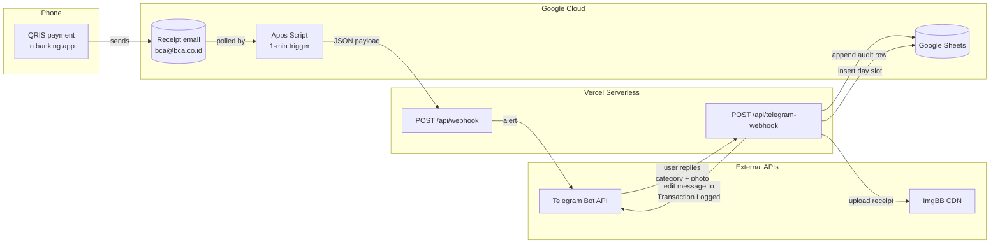
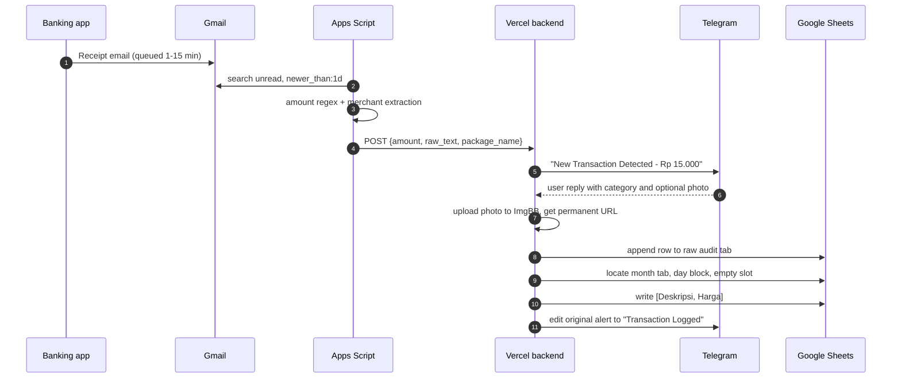

# BCA Auto Logger

Automated bookkeeping for daily QRIS payments and bank transfers: a payment
receipt becomes a categorized ledger row with a linked photo, without opening a
spreadsheet.

Built for a personal workflow that runs on QRIS taps and transfers, where the
bank deliberately sends no push notification and often no email either — so the
interesting part of this project is not the CRUD, it is the ingestion problem.

<p align="left">
  
  
  
  
  
</p>

---

## Table of contents

- [The problem](#the-problem)
- [Architecture](#architecture)
- [How a transaction flows](#how-a-transaction-flows)
- [Engineering decisions](#engineering-decisions)
- [The dead end, documented](#the-dead-end-documented)
- [Data model](#data-model)
- [Setup](#setup)
- [Endpoints](#endpoints)
- [Scope and limitations](#scope-and-limitations)
- [Stack](#stack)

---

## The problem

Manual expense tracking fails for one reason: the friction sits exactly where
attention is lowest. You tap a QRIS code at a food stall, and the moment to
record it is the moment you are least willing to open a spreadsheet.

The goal was narrow and measurable: **make the recording step take one message
instead of eight fields.**

Constrain it further with the reality of the source:

- The bank app emits **no status-bar notification** for a user-initiated payment,
  so there is nothing for a `NotificationListenerService` to read.
- Receipt emails exist but arrive **1-15 minutes late** when they arrive at all.
- Any solution running on the phone is subject to OEM battery managers killing
  background services.

The pipeline had to be asynchronous, cloud-hosted, and tolerant of a lossy source.

---

## Architecture



Three runtimes, one contract: the ingestion layer speaks JSON to the backend, so
either side can be replaced without touching the other.

---

## How a transaction flows



The reply is the only human step. Everything before and after it is automatic.

---

## Engineering decisions

The parts worth reading.

### 1. Idempotency without a database

Serverless functions share no memory between invocations, so there is nowhere to
put an "already processed" flag. Telegram messages, however, are mutable and
addressable by id.

On a successful write the original alert is edited in place:

```
Transaction Logged
Amount: Rp 15000
Category: Kopi
Status: Saved to Google Sheets
```

A second reply to the same message is detected by inspecting the parent message
text before any write, and rejected with a warning. The state lives in the
conversation, which means it survives redeploys, cold starts, and free-tier
infrastructure.

*Trade-off:* editing the source message mutates the user's history. For a
single-user tool that is acceptable; for multi-user it would need real state.

### 2. Amount is re-parsed from the message, not held in memory

`let pendingAmount` was the first implementation and it was wrong: Vercel
discards it between invocations, so the value was frequently `Unknown`. The
amount is now recovered by regex from the quoted alert text
(`/Amount:\s*Rp\s*([0-9.,]+)/i`), making the write path stateless.

### 3. Two writes, independently isolated

Every transaction is written twice: an append-only audit row, and a placement
into the human-readable monthly grid. Each runs in its own `try/catch`, and the
transaction only reports failure if **both** fail.

This exists because of a real outage. The audit tab was renamed from
`Raw_Transactions` to `Raw/lost Transactions`; the hardcoded range threw
`Unable to parse range`, the uncaught exception aborted the handler, and the
primary monthly write was silently skipped. Users saw an alert, replied, and
nothing happened.

Lessons applied:

- tab names are resolved at runtime (exact match, then any tab containing `raw`,
  then create it) instead of hardcoded;
- every range is quoted — `'${title}'!A:D` — because spaces and slashes break
  unquoted A1 notation;
- a failure in the secondary write cannot abort the primary one.

### 4. Calendar grids are generated, not copied

The user maintains a horizontal ledger: five weeks side by side, each block of
three columns (`Hari/tanggal`, `Deskripsi`, `Harga`), roughly five spare rows per
day, a `Total` row with `=SUM()`.

Rather than ask the user to duplicate a template every month, the backend
reconstructs it: week header row, day labels positioned by weekday
(`Senin` row 3, `Selasa` 8, `Rabu` 13, `Kamis` 19, `Jumat` 25, `Sabtu` 30,
`Minggu` 35), weeks every four columns, green header fill, solid borders, and
`=SUM()` per week.

One detail that mattered: a generated month includes adjacent-month dates
(`November 2026` Week 1 begins `Senin 26 Oktober`), so matching a day cell by
number alone hits the wrong block. Matching runs twice — day number **plus**
month name first, bare day number only as a fallback.

### 5. Photos are hosted, not linked to Telegram

Telegram file URLs are temporary and embed the bot token in the URL string. An
image written straight into a spreadsheet cell breaks within hours and leaks the
credential. Receipts are therefore streamed to ImgBB and stored as a permanent
CDN link, then rendered in-cell as:

```
=HYPERLINK(url, IMAGE(url))
```

Readable text, clickable to full resolution, valid indefinitely.

### 6. Polling is opt-in, because it destroys the webhook

`node-telegram-bot-api` calls `deleteWebhook()` on construction whenever it
starts polling. With `{ polling: !isVercel }`, a single local `node server.js`
run silently unbound the deployed webhook; the bot still sent messages, so it
looked healthy while every reply was stranded in Telegram's queue.

Polling is now gated behind `ENABLE_POLLING === 'true'`. The recovery signal is
`getWebhookInfo` returning an empty `url` with a non-zero
`pending_update_count`.

---

## The dead end, documented

The first implementation was an Android `NotificationListenerService`, and it
was abandoned. The post-mortem is more useful than the code:

| Assumption | Reality |
| :--- | :--- |
| Payments raise a notification | The app shows an in-app receipt, not a status-bar notification |
| Notification extras contain the amount | Banking apps render custom `RemoteViews`; `EXTRA_TEXT` is null or generic |
| Extras survive to third-party listeners | `VISIBILITY_PRIVATE` masks financial content from listener services |
| A background service stays alive | OEM battery managers unbind it within minutes of screen-off |
| Sideloaded APKs get notification access | Android 13+ restricted settings block it until manually overridden |

The rewrite also corrected an earlier incorrect assumption about email coverage:
receipts for QRIS *are* sent, just slowly, which is why the freshness window is
30 minutes rather than 5. A 5-minute window silently discarded real payments.

The abandoned client is kept in this repository under `BCAAutoLogger/` for
reference. It compiles and runs; it just cannot see the events it needs.

---

## Data model

### Raw audit tab (`Raw/lost Transactions`)

| Column | Field | Example |
| :--- | :--- | :--- |
| A | Timestamp (Asia/Jakarta) | `02/11/2026, 13.48.40` |
| B | Category | `Kopi kenangan` |
| C | Amount (integer) | `20000` |
| D | Receipt | `=HYPERLINK(url, IMAGE(url))` or `No Image` |

### Monthly ledger (e.g. `November 2026`)

```text
        A              B            C   D        E              F          G
1              Minggu 1                            Minggu 2
2   Hari/tanggal   Deskripsi   Harga       Hari/tanggal   Deskripsi   Harga
3   Senin 2 Nov    Kopi        20000       Senin 9 Nov
4                  Kue         10000
...
40  Total                      =SUM(...)   Total                      =SUM(...)
```

---

## Setup

### 1. Google Sheets

Create a spreadsheet. Create a service account in Google Cloud, enable the
Sheets API, download the JSON key, and share the spreadsheet with the service
account email as **Editor**.

### 2. Backend

```bash
git clone https://github.com/zevlord/bca-server.git
cd bca-server
npm install
cp .env.example .env      # fill in the values
npm start                 # http://localhost:3000
```

### 3. Deploy

```bash
npx vercel --prod
```

Set the same environment variables in Vercel → Settings → Environment Variables,
then verify:

```bash
curl https://your-deployment.vercel.app/readyz
# { "ready": true, "checks": { "telegram_token": true, ... } }
```

### 4. Register the Telegram webhook

```bash
curl "https://api.telegram.org/bot<TOKEN>/setWebhook?url=https://your-deployment.vercel.app/api/telegram-webhook"
```

Verify with `getWebhookInfo`. Never wrap the token in angle brackets — the Bot
API treats them literally and returns a 404.

### 5. Ingestion script

See [`apps-script/`](apps-script/) for the Gmail polling layer and trigger setup.

---

## Endpoints

| Method | Path | Purpose |
| :--- | :--- | :--- |
| `GET` | `/healthz` | Liveness. Returns `OK`. |
| `GET` | `/readyz` | Configuration readiness as booleans. Never returns values. |
| `POST` | `/api/webhook` | Ingestion entry point. Accepts `{amount, raw_text, package_name}`. |
| `POST` | `/api/telegram-webhook` | Telegram update receiver. |
| `GET` | `/` | Recent transactions dashboard. Gated by `DASHBOARD_SECRET` when set. |

---

## Scope and limitations

Written down honestly, because a portfolio project that claims no limits reads
as unexamined.

- **Single user.** One `CHAT_ID`, one spreadsheet. Multi-tenancy would need
  per-user state and a real datastore.
- **Email-only coverage.** Transaction types that exist only as an in-app receipt
  are not captured by the ingestion layer.
- **Latency is inherited.** The bank's queue decides when a transaction appears.
- **No automated tests.** The write path is exercised manually against a live
  sheet. The pure functions (`colToLetter`, grid generation, amount parsing) are
  the obvious candidates for the first test suite.
- **Receipts are public.** ImgBB links are unlisted but unauthenticated; anyone
  with the URL can view the image. Sensitive documents would need private
  object storage with signed URLs.

---

## Stack

| Layer | Choice | Why |
| :--- | :--- | :--- |
| Ingestion | Google Apps Script | Only supported way to poll Gmail on a schedule without hosting OAuth |
| Backend | Node.js + Express 5 | Minimal surface for four routes |
| Hosting | Vercel serverless | Zero-cost, no idle process to keep alive |
| Storage | Google Sheets API v4 | The destination the user already maintains by hand |
| Auth | Google service account | Decouples backend identity from the human's login |
| Interface | Telegram Bot API | A chat client the user already has open |
| Images | ImgBB | Permanent public URL, free, no OAuth dance |
| Legacy client | Android (Java) | Abandoned after the capability analysis above |

---

## License

MIT — see [LICENSE](LICENSE).
